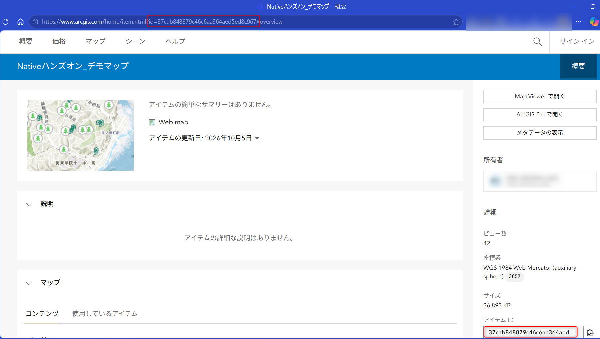
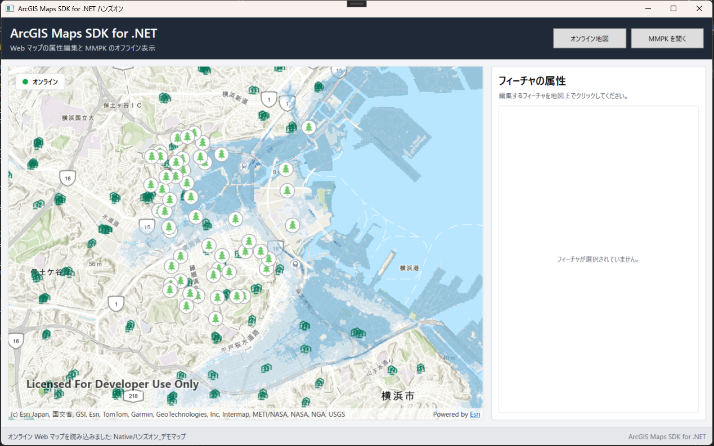
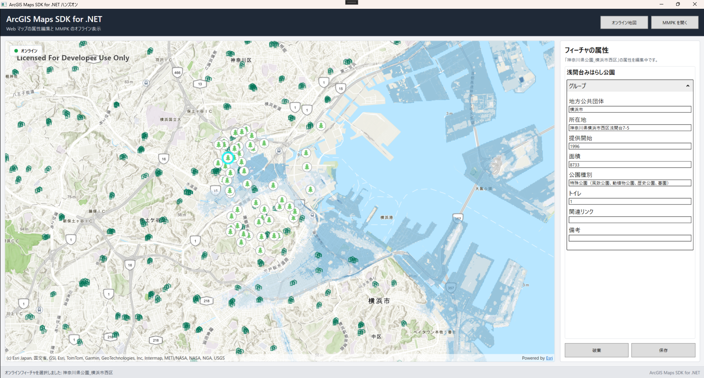
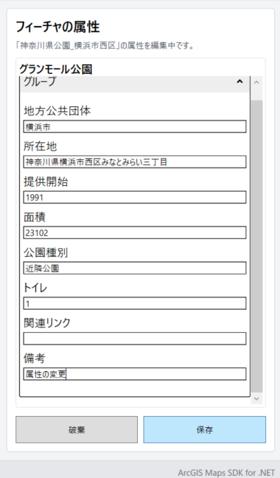
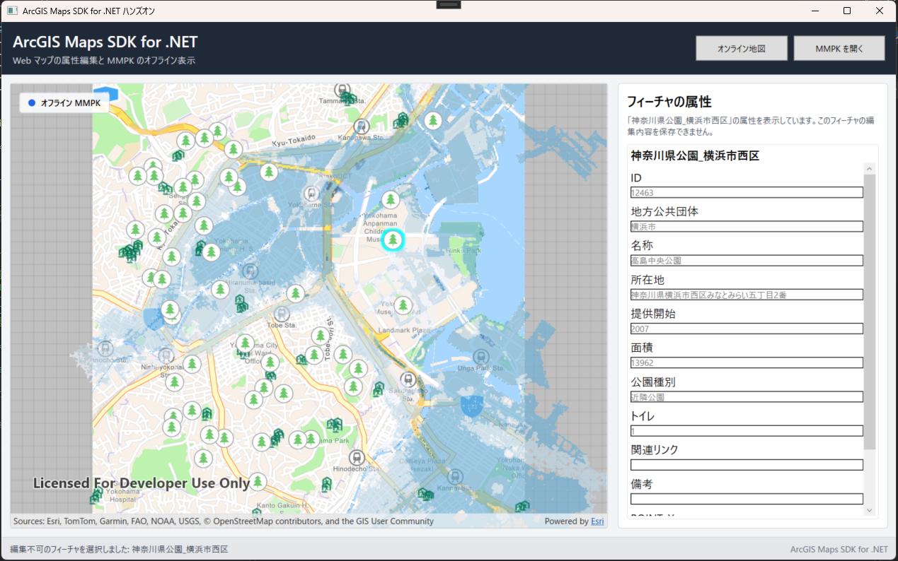

# .NET で学ぶ ArcGIS ネイティブ アプリ開発基礎（ハンズオン）

## 概要

このガイドでは、[ArcGIS Maps SDK for .NET](https://developers.arcgis.com/net/) と [ArcGIS Maps SDK for .NET Toolkit](https://developers.arcgis.com/net/toolkit/) を使って、次の機能を持つ WPF デスクトップ アプリケーションを作成します。

- ArcGIS Online の Web マップを表示する（オンライン）
- 地図上のフィーチャをクリックして、属性をフォーム（FeatureFormView）に表示する
- フォームで属性を編集し、フィーチャ サービスへ保存する
- モバイル マップ パッケージ（MMPK）を読み込んで、オフラインで地図を表示する

このハンズオンでは、コピー & ペーストでアプリケーションを作成できます。雛形のソース コードには `手順 x-x ～ Start` と `手順 x-x ～ End` のコメントが記述されています。本ガイドの各手順のコードをコピーし、雛形の該当コメントの間に貼り付けてください。一部の手順では、コードを追加するのではなく既存の記述を変更します。その場合は、該当のコードに書き換えてください。

> [!NOTE]
> 本ガイドは ArcGIS Maps SDK for .NET 300.1 を対象としています。

## 準備

### 必要な環境

- Windows 10 / 11
- Visual Studio 2022（17.8）以降と「.NET デスクトップ開発」ワークロード
- .NET 8 または .NET 10
- ArcGIS Location Platform アカウントまたは ArcGIS Online アカウント
- 背景地図（ベースマップ）にアクセスできる API キー

> [!NOTE]
>API キーは [ArcGIS Location Platform](https://location.arcgis.com/) または ArcGIS Online の開発者の認証情報から[作成できます](https://esrijapan.github.io/arcgis-dev-resources/guide/get-api-key/)。作成時には、ベースマップ（Basemap Styles service）にアクセスする権限を付与してください。

### 手順 0 : プロジェクトの準備（ハンズオンでは行いません）

ハンズオンでは、以下の手順で作成済みの雛形プロジェクト「ArcGisNativeSdkHandsOn」を使用します。

1. Visual Studio を起動し、\[新しいプロジェクトの作成\] から **WPF アプリケーション**（C#）を選択します。
2. プロジェクト名に `ArcGisNativeSdkHandsOn` と入力し、フレームワークに **.NET 8.0** または **.NET 10** を選択してプロジェクトを作成します。
3. ソリューション エクスプローラーでプロジェクトをダブルクリックして .csproj を開き、ターゲット OS バージョンを 10.0.19041.0 以上に変更します。

```xml
<TargetFramework>net10.0-windows10.0.19041.0</TargetFramework>
```

4. \[F5\] キーを押してアプリケーションを実行し、空のウィンドウが表示されることを確認します。

---

### 手順 1 : 必要なライブラリーの追加

ArcGIS Maps SDK for .NET の WPF 用ライブラリーと、UI 部品を提供する Toolkit を NuGet で追加します。

1. ソリューション エクスプローラーでプロジェクトを右クリックし、\[NuGet パッケージの管理\] を選択します。
2. \[参照\] タブで以下のパッケージを検索し、インストールします。
   - `Esri.ArcGISRuntime.WPF`
   - `Esri.ArcGISRuntime.Toolkit.WPF`

コマンドラインで追加する場合は、以下を実行します。

```bash
dotnet add package Esri.ArcGISRuntime.WPF
dotnet add package Esri.ArcGISRuntime.Toolkit.WPF
```

`Esri.ArcGISRuntime.WPF` を追加すると、地図表示や GIS 機能の API に加えて、WPF 用の地図コントロールである `MapView` を使用できるようになります。また、`Esri.ArcGISRuntime.Toolkit.WPF` を追加すると、凡例や検索などの UI コントロールを使用できるようになります。今回は Toolkit の `FeatureFormView` を使用して、属性の表示・編集フォームを作成します。

---

### 手順 2 : 認証情報（API キー）の入力

`App.xaml.cs` を開き、`"YourApiKey"` をご自身の API キーに書き換えます。

```csharp
            /*--手順2: API キーを入力--*/
            const string apiKey = "YourApiKey";
```

`App.xaml.cs` では、アプリケーション起動時に `ArcGISRuntimeEnvironment.Initialize()` で SDK を初期化し、API キーが入力されている場合のみ `ArcGISRuntimeEnvironment.ApiKey` に設定しています。初期化に失敗した場合は、エラー メッセージを表示してアプリケーションを終了します。

> [!IMPORTANT]
> API キーはアクセス トークンです。コードに直接記述する方法は推奨されていません。GitHub などに公開するリポジトリへ直接コミットしないよう注意してください。

---

### 手順 3 : 地図を表示する

> [!NOTE]
>ArcGIS Maps SDK for .NET では、地図を表すモデルを `Map`、その地図を画面に描画して操作を受け付ける WPF コントロールを `MapView` と呼びます。`Map` は「何を表示するか（ベースマップやレイヤーの集合）」、`MapView` は「どう表示・操作するか」を担当します。

#### 手順 3-1 : esri 名前空間の宣言

ArcGIS のコントロールを XAML で使えるようにするため、`MainWindow.xaml` の `Window` 要素に esri 名前空間を追加します。

```xml
<!--手順3-1: 名前空間の宣言 Start-->
<Window x:Class="ArcGisNativeSdkHandsOn.MainWindow"
        xmlns="http://schemas.microsoft.com/winfx/2006/xaml/presentation"
        xmlns:x="http://schemas.microsoft.com/winfx/2006/xaml"
        xmlns:d="http://schemas.microsoft.com/expression/blend/2008"
        xmlns:mc="http://schemas.openxmlformats.org/markup-compatibility/2006"
        xmlns:esri="http://schemas.esri.com/arcgis/runtime/2013"
        mc:Ignorable="d"
        Title="ArcGIS Maps SDK for .NET ハンズオン"
        Width="1280"
        Height="800"
        MinWidth="900"
        MinHeight="600"
        WindowStartupLocation="CenterScreen">
<!--手順3-1: 名前空間の宣言 End-->
```

#### 手順 3-2 : MapView コントロールの配置

`MainWindow.xaml` の「地図」領域に `MapView` を配置します。`GeoViewTapped` イベントは、手順 4 で地図上のクリックを処理するために使用します。

```xml
                <Grid>
                    <!--手順3-2: Map View コントロールを配置 Start-->
                    <esri:MapView x:Name="MyMapView"
                                    GeoViewTapped="MyMapView_GeoViewTapped" />
                    <!--手順3-2: Map View コントロールを配置 End-->

                    <!-- ロード中表示 -->
                    <Border x:Name="BusyPanel"
                            Background="#99000000"
                            Visibility="Collapsed">
```

#### 手順 3-3 : ポータルとアイテム ID の設定

表示する Web マップを、ポータルの URL とアイテム ID で指定します。`MainWindow.xaml.cs` の `MainWindow` クラスを以下のように記述します。

```csharp
public partial class MainWindow : Window
{
    /*--手順3-3: ポータルとアイテム Id を設定する Start--*/
    private static readonly Uri PortalUri = new("https://www.arcgis.com");

    private const string WebMapItemId = "37cab848879c46c6aa364aed5ed8c967";
    /*--手順3-3: ポータルとアイテム Id を設定する End--*/
```

今回使用する Web マップのアイテム詳細ページは以下です。  
[https://www.arcgis.com/home/item.html?id=37cab848879c46c6aa364aed5ed8c967](https://www.arcgis.com/home/item.html?id=37cab848879c46c6aa364aed5ed8c967)

ArcGIS Location Platform や ご自身の組織の ArcGIS Online、 ArcGIS Enterprise を使用する場合は、`PortalUri` をご自身のポータルの URL に書き換えてください。アイテム ID は、アイテム詳細ページの URL パラメーター `id` の値、もしくは画面右側の **アイテム ID** で確認できます。ご自身の Web マップを使用する場合は、`WebMapItemId` をその値に書き換えてください。



> Web マップや、Web マップで使用しているフィーチャ サービスの共有レベルが「所有者」や「組織」の場合は、認証の実装が必要です。本ハンズオンでは認証は実装しません。

#### 手順 3-4 : MapView に Web マップを設定

`MainWindow.xaml.cs` 内の `OpenOnlineMapAsync` メソッド内に、ポータルからアイテムを読み込んで `Map` を生成し、`MapView` に設定する処理を記述します。

```csharp
            if (WebMapItemId == "YourWebMapItemId" || string.IsNullOrWhiteSpace(WebMapItemId))
{
    throw new InvalidOperationException(
        "MainWindow.xaml.cs の WebMapItemId を、" +
        "使用する Web マップの Item ID に変更してください。");
}

/*--手順3-4: MapView コントローラーに Web マップを設定 Start--*/
ArcGISPortal portal = await ArcGISPortal.CreateAsync(PortalUri);

PortalItem portalItem = await PortalItem.CreateAsync(portal, WebMapItemId);

Map onlineMap = new(portalItem);

await onlineMap.LoadAsync();

if (onlineMap.LoadStatus != LoadStatus.Loaded)
{
    throw onlineMap.LoadError ??
          new InvalidOperationException("Web マップを読み込めませんでした。");
}

MyMapView.Map = onlineMap;
/*--手順3-4: MapView コントローラーに Web マップを設定 End--*/

_isOnlineMode = true;

SetMode( "オンライン", Color.FromRgb(22, 163, 74));
```

ここでは、非同期で ArcGIS ポータル（`ArcGISPortal`）にアクセスし、アイテム（`PortalItem`）を読み込んで `Map` を生成しています。`LoadAsync` で読み込みを待ち、失敗した場合は `LoadError` を例外として投げ、画面にエラーを表示します。読み込みに成功したら、手順 3-2 で配置した `MyMapView` の `Map` プロパティに設定します。

`OpenOnlineMapAsync` は、ウィンドウの表示時（`MainWindow_Loaded`）と、ヘッダーの \[オンライン地図\] ボタンのクリック時に呼び出されます。

Web マップには、ベースマップ、レイヤー、表示範囲、シンボル、ポップアップ、フォームなどの設定が保存されているため、ArcGIS Online 上で設定したデザインの地図をそのままアプリケーションに表示できます。地図の見た目や構成を ArcGIS Online 側で管理し、アプリケーションでは振る舞いをコードで実装する、という役割分担が ArcGIS における開発の基本的な考え方です。

アプリケーションを実行すると、Web マップが表示され、地図左上のモード表示が緑色の「オンライン」になります。マウス ホイールによる拡大・縮小やドラッグによる移動は、`MapView` に標準で組み込まれています。



> [!NOTE]
> 本番ライセンスを設定していない状態では、地図上に「Licensed For Developer Use Only」という透かしが表示されます。開発・テストでは SDK の全機能を利用できますが、アプリケーションを本番配布する際には別途ライセンスの設定が必要です。

> ArcGIS Maps SDK for .NET では、地図の読み込みやフィーチャの検索などの処理は非同期で実行されます。`await` で結果を待つとともに、ネットワーク エラーなどに備えて例外処理を記述しておくことが重要です。

---

### 手順 4 : フィーチャの属性情報を表示する

地図上でクリックしたフィーチャを特定し、その属性を Toolkit の `FeatureFormView` に表示します。

#### 手順 4-1 : FeatureFormView の配置

`MainWindow.xaml` の「属性編集パネル」に `FeatureFormView` を配置します。フィーチャが選択されるまでは非表示（`Collapsed`）にしておきます。

```xml
                        <Grid>
                            <TextBlock x:Name="NoFeatureText"
                                Text="フィーチャが選択されていません。"
                                Foreground="#6B7280"
                                TextWrapping="Wrap"
                                TextAlignment="Center"
                                HorizontalAlignment="Center"
                                VerticalAlignment="Center" />

                            <!--手順4-1: FeatureFormView を配置 Start-->
                            <esri:FeatureFormView x:Name="FeatureFormViewPanel"
                                                    Visibility="Collapsed" />
                            <!--手順4-1: FeatureFormView を配置 End-->
                        </Grid>
```

#### 手順 4-2 : クリックされたフィーチャの識別

`MainWindow.xaml.cs` 内の `MyMapView_GeoViewTapped` メソッド内に、クリックした位置のフィーチャを識別する処理を記述します。

```csharp
            ClearSelectedFeature();

            /*--手順4-2 クリックされたフィーチャを識別 Start--*/
            IReadOnlyList<IdentifyLayerResult> identifyResults =
                await MyMapView.IdentifyLayersAsync(
                    e.Position,
                    tolerance: 12, // 
                    returnPopupsOnly: false);

            (ArcGISFeature? feature, FeatureLayer? layer) =
                FindFirstFeature(identifyResults);

            if (feature is null || layer is null)
            {
                StatusText.Text =
                    "クリックした位置にフィーチャはありません。";

                FeatureHelpText.Text =
                    "別のフィーチャをクリックしてください。";

                return;
            }

            await feature.LoadAsync();

            _selectedFeature = feature;
            _selectedFeatureLayer = layer;

            _selectedFeatureLayer.SelectFeature(_selectedFeature);

            ShowFeatureForm(feature, layer, isEditable: _isOnlineMode);
            /*--手順4-2 クリックされたフィーチャを識別 End--*/
        }
```

`MapView` の [GeoViewTapped](https://developers.arcgis.com/net/api-reference/api/netwin/wpf/Esri.ArcGISRuntime.UI.Controls.GeoView.GeoViewTapped.html) イベントでクリックした画面上の位置（`e.Position`）を受け取り、`IdentifyLayersAsync` メソッドで、その位置から許容範囲 12 ピクセル以内にあるフィーチャを地図内の全レイヤーから検索しています。

検索結果は、雛形に用意されている `FindFirstFeature` メソッドで調べ、最初に見つかった `ArcGISFeature` と、そのフィーチャが属する `FeatureLayer` を取得します。グループ レイヤーなどのサブレイヤーも再帰的に調べています。最後に `LoadAsync` でフィーチャの全属性を読み込みます。

取得したフィーチャは、`SelectFeature` で地図上で選択状態（ハイライト表示）にした後、`ShowFeatureForm` メソッドに渡されます。

#### 手順 4-3 : FeatureForm の作成と FeatureFormView への設定

`MainWindow.xaml.cs` 内の `ShowFeatureForm` メソッド内に、選択したフィーチャから `FeatureForm` を作成し、手順 4-1 で配置した `FeatureFormView` に設定する処理を記述します。

```csharp
    private void ShowFeatureForm(ArcGISFeature feature, FeatureLayer layer, bool isEditable)
    {
        /*--手順4-3: FeatureForm を作成して、パネルに設定 Start--*/
        FeatureForm featureForm = new(feature);

        FeatureFormViewPanel.FeatureForm = featureForm;

        NoFeatureText.Visibility = Visibility.Collapsed;

        FeatureFormViewPanel.Visibility = Visibility.Visible;
        /*--手順4-3: FeatureForm を作成して、パネルに設定 End--*/
```

`FeatureForm` は、フィーチャの属性を編集するためのフォームのモデルです。`FeatureFormView` に設定するだけで、フィールドの型に応じたテキスト ボックスやコンボ ボックスなどの入力 UI が自動的に作成されます。フォームの構成は、Web マップのレイヤーに設定されたフォームの定義に基づきます。

#### 手順 4-4 : 選択の解除

`MainWindow.xaml.cs` 内の `ClearSelectedFeature` メソッド内に、地図上の選択とフォームの表示をリセットする処理を記述します。

```csharp
    private void ClearSelectedFeature()
    {
        /*--手順4-4: 選択されたフィーチャをクリア Start--*/
        if (_selectedFeatureLayer is not null && _selectedFeature is not null)
        {
            _selectedFeatureLayer.UnselectFeature(_selectedFeature);
        }

        _selectedFeature = null;
        _selectedFeatureLayer = null;

        FeatureFormViewPanel.FeatureForm = null;

        FeatureFormViewPanel.Visibility = Visibility.Collapsed;

        NoFeatureText.Visibility = Visibility.Visible;

        EditButtonsPanel.Visibility = Visibility.Collapsed;
        /*--手順4-4: 選択されたフィーチャをクリア End--*/
```

`ClearSelectedFeature` は、別のフィーチャをクリックしたとき、地図を切り替えたとき、保存・破棄の後に呼び出されます。

アプリケーションを実行し、地図上のフィーチャをクリックすると、フィーチャがハイライト表示され、右側のパネルに属性が表示されます。



---

### 手順 5 : フィーチャの属性情報を編集する

フォームで編集した属性を確定し、フィーチャ サービスへ反映します。編集は、「① 編集内容をテーブル（ローカル）に保存」→「② サービスへ反映（Apply Edits）」の 2 段階で行います。

#### 手順 5-1 : 編集可能なフィーチャの選択時にボタンを表示

`MainWindow.xaml.cs` 内の `ShowFeatureForm` メソッド内（手順 4-3 の下）に、編集可能な場合に \[保存\]・\[破棄\] ボタンを表示・有効化する処理を記述します。

```csharp
        /*--手順5-1: 編集可能なフィーチャを選択時にボタンを表示する Start--*/
        if (isEditable)
        {
            EditButtonsPanel.Visibility = Visibility.Visible;

            SaveButton.IsEnabled = true;
            DiscardButton.IsEnabled = true;

            FeatureHelpText.Text = $"「{GetLayerDisplayName(layer)}」の属性を編集中です。";

            StatusText.Text = $"オンライン フィーチャを選択しました: " + GetLayerDisplayName(layer);
        }
        /*--手順5-1: 編集可能なフィーチャを選択時にボタンを表示する End--*/
```

`isEditable` には、オンライン地図を表示しているかどうか（`_isOnlineMode`）が渡されます。

#### 手順 5-2 : FeatureForm の編集内容を確定してサービスへ反映

`MainWindow.xaml.cs` 内の `SaveButton_Click` メソッド内に、保存処理を記述します。

```csharp
        try
        {
            SetBusy(true, "変更を保存しています...");

            /*--手順5-2: FeatureForm の編集内容を確定 Start--*/
            bool formSaved = await FeatureFormViewPanel.FinishEditingAsync(requireAllErrorsResolved: true);

            if (!formSaved)
            {
                StatusText.Text =
                    "入力内容にエラーがあります。表示された項目を修正してください。";

                return;
            }

            if (_selectedFeature.FeatureTable is not ServiceFeatureTable serviceFeatureTable)
            {
                throw new InvalidOperationException(
                    "選択したフィーチャは " +
                    "ServiceFeatureTable に属していません。");
            }

            ServiceGeodatabase? serviceGeodatabase = serviceFeatureTable.ServiceGeodatabase;

            if (serviceGeodatabase?.ServiceInfo?.CanUseServiceGeodatabaseApplyEdits == true)
            {
                await serviceGeodatabase.ApplyEditsAsync();
            }
            else
            {
                await serviceFeatureTable.ApplyEditsAsync();
            }

            StatusText.Text = "編集内容をオンラインサービスへ反映しました。";

            MessageBox.Show(
                "編集内容をオンラインサービスへ反映しました。",
                "保存完了",
                MessageBoxButton.OK,
                MessageBoxImage.Information);

            ClearSelectedFeature();
            /*--手順5-2: FeatureForm の編集内容を確定 End--*/
        }
```

- `FeatureFormView.FinishEditingAsync(requireAllErrorsResolved: true)` は、フォームの入力内容を検証し、エラーがなければフィーチャのテーブルに保存します。エラーがある場合は `false` を返し、最初のエラー項目までスクロールします。
- 保存しただけでは、変更はアプリ内のテーブルに保持されている状態です。`ApplyEditsAsync` を呼び出すことで、変更がフィーチャ サービスへ送信されます。
- サービスが `ServiceGeodatabase` 単位での反映に対応している場合は `ServiceGeodatabase.ApplyEditsAsync`、対応していない場合は `ServiceFeatureTable.ApplyEditsAsync` を使用しています。

#### 手順 5-3 : 編集ボタンの無効化

`MainWindow.xaml.cs` 内の `ClearSelectedFeature` メソッド内（手順 4-4 の下）に、\[保存\]・\[破棄\] ボタンを無効化する処理を記述します。

```csharp
        /*--手順5-3: 編集ボタンを無効化 Start--*/
        SaveButton.IsEnabled = false;
        DiscardButton.IsEnabled = false;
        /*--手順5-3: 編集ボタンを無効化 End--*/
    }
```

\[破棄\] ボタン（`DiscardButton_Click`）は雛形に実装済みです。`FinishEditingAsync` を実行する前の変更はフォーム内に保持されているため、`ClearSelectedFeature` でフォームを閉じることで破棄しています。

アプリケーションを実行し、フィーチャを選択して属性を変更した後、\[保存\] ボタンをクリックすると、「保存完了」のメッセージが表示されます。同じフィーチャを再度クリックし、変更が反映されていることを確認してください。



---

### 手順 6 : オフラインでの地図表示を実装する

ArcGIS Pro で作成したモバイル マップ パッケージ（MMPK）を読み込み、ネットワークに接続していない環境でも地図を表示できるようにします。

#### 手順 6-1 : MMPK のパスを指定

`MainWindow.xaml.cs` の `MainWindow` クラスに、MMPK のパスを記述します。今回は、アプリケーションの出力フォルダー内の `Data` フォルダーに `HandsonMap.mmpk` として配置します。

```csharp
    /*--手順6-1: MMPK を読み込む Start--*/
    // 出力フォルダーへコピーされる MMPK の相対パス。
    private static readonly string MmpkPath =
        Path.Combine(AppContext.BaseDirectory,"Data","HandsonMap.mmpk");
    /*--手順6-1: MMPK を読み込む End--*/
```

配布した `HandsonMap.mmpk` をプロジェクトの `Data` フォルダーに配置し、ビルド時に出力フォルダーへコピーされるよう設定してください。ソリューション エクスプローラーでファイルを選択し、プロパティの \[出力ディレクトリーにコピー\] を \[新しい場合はコピーする\] に設定するか、.csproj に以下を記述します。

```xml
<ItemGroup>
  <None Update="Data\HandsonMap.mmpk">
    <CopyToOutputDirectory>PreserveNewest</CopyToOutputDirectory>
  </None>
</ItemGroup>
```

#### 手順 6-2 : モバイル マップ パッケージを表示

`MainWindow.xaml.cs` 内の `OpenOfflineMapAsync` メソッド内に、MMPK を開いて地図を表示する処理を記述します。

```csharp
            _mobileMapPackage?.Close();
            _mobileMapPackage = null;

            /*--手順6-2 モバイル マップ パッケージを表示する Start--*/
            _mobileMapPackage = await MobileMapPackage.OpenAsync(MmpkPath);
            await _mobileMapPackage.LoadAsync();

            if (_mobileMapPackage.LoadStatus != LoadStatus.Loaded)
            {
                throw _mobileMapPackage.LoadError ??
                      new InvalidOperationException("MMPK を読み込めませんでした。");
            }

            Map? offlineMap = _mobileMapPackage.Maps.FirstOrDefault();

            if (offlineMap is null)
            {
                throw new InvalidOperationException(
                    "MMPK に表示可能なマップが含まれていません。");
            }

            MyMapView.Map = offlineMap;
            /*--手順6-2 モバイル マップ パッケージを表示する End--*/

            _isOnlineMode = false;
```

`MobileMapPackage.OpenAsync` で MMPK を開き、`LoadAsync` で読み込みます。MMPK には複数のマップを含めることができるため、`Maps` から最初のマップを取得して `MyMapView` に設定しています。オンラインの Web マップと同じ `Map` クラスとして扱えるため、表示や識別（Identify）の処理はそのまま利用できます。

なお、MMPK を開いている間はファイルがロックされるため、別の MMPK を開く前やウィンドウを閉じるとき（`MainWindow_Closed`）に `Close` を呼び出して解放しています。

#### 手順 6-3 : MMPK のフィーチャを選択した場合の処理

`MainWindow.xaml.cs` 内の `ShowFeatureForm` メソッド内（手順 5-1 の `if` ブロックの直後）に、編集不可のフィーチャを選択した場合の処理を記述します。

```csharp
        /*--手順6-3: MMPK のフィーチャを選択した場合 Start--*/
        else
        {
            // MMPK では保存操作を提供しない
            EditButtonsPanel.Visibility = Visibility.Collapsed;

            SaveButton.IsEnabled = false;
            DiscardButton.IsEnabled = false;

            FeatureHelpText.Text =
                $"「{GetLayerDisplayName(layer)}」の属性を表示しています。" +
                "このフィーチャの編集内容を保存できません。";

            StatusText.Text =
                $"編集不可のフィーチャを選択しました: " +
                GetLayerDisplayName(layer);
        }
        /*--手順6-3: MMPK のフィーチャを選択した場合 End--*/
    }
```

このサンプルでは MMPK の属性編集は行わないため、オフライン地図のフィーチャを選択した場合は属性の表示のみとし、\[保存\]・\[破棄\] ボタンを表示しません。

アプリケーションを実行し、ヘッダーの \[MMPK を開く\] ボタンをクリックすると、地図左上のモード表示が青色の「オフライン MMPK」になり、MMPK の地図が表示されます。\[オンライン地図\] ボタンをクリックすると、Web マップの表示に戻ります。



---

以上で、今回ご用意した手順は終わりです。手順をなぞると以下のようなソース コードになります。手順に沿って進めてうまくいかなかった場合は、以下のソース コードをご確認ください。

### 完成版のソースコード

#### App.xaml.cs

<details>
<summary>ソース コードの詳細</summary>

```csharp
using Esri.ArcGISRuntime;
using System.Windows;

namespace ArcGisNativeSdkHandsOn;

public partial class App : Application
{
    protected override void OnStartup(StartupEventArgs e)
    {
        base.OnStartup(e);

        try
        {
            ArcGISRuntimeEnvironment.Initialize();

            /*--手順2: API キーを入力--*/
            const string apiKey = "YourApiKey";

            if (!string.IsNullOrWhiteSpace(apiKey) &&
            apiKey != "YourApiKey")
            {
                ArcGISRuntimeEnvironment.ApiKey = apiKey;
            }
        }
        catch (Exception exception)
        {
            MessageBox.Show(
            $"ArcGIS Maps SDK の初期化に失敗しました。\n\n{exception.Message}",
            "初期化エラー",
            MessageBoxButton.OK,
            MessageBoxImage.Error);

            Shutdown();
        }
    }
}
```
</details>

#### MainWindow.xaml

<details>
<summary>ソース コードの詳細</summary>

```xml
<!--手順3-1: 名前空間の宣言-->
<Window x:Class="ArcGisNativeSdkHandsOn.MainWindow"
        xmlns="http://schemas.microsoft.com/winfx/2006/xaml/presentation"
        xmlns:x="http://schemas.microsoft.com/winfx/2006/xaml"
        xmlns:d="http://schemas.microsoft.com/expression/blend/2008"
        xmlns:mc="http://schemas.openxmlformats.org/markup-compatibility/2006"
        xmlns:esri="http://schemas.esri.com/arcgis/runtime/2013"
        mc:Ignorable="d"
        Title="ArcGIS Maps SDK for .NET ハンズオン"
        Width="1280"
        Height="800"
        MinWidth="900"
        MinHeight="600"
        WindowStartupLocation="CenterScreen">

    <Grid Background="#F3F4F6">

        <Grid.RowDefinitions>
            <RowDefinition Height="Auto" />
            <RowDefinition Height="*" />
            <RowDefinition Height="Auto" />
        </Grid.RowDefinitions>

        <!-- ヘッダー -->
        <Border Grid.Row="0"
                Padding="16,12"
                Background="#1F2937">

            <Grid>
                <Grid.ColumnDefinitions>
                    <ColumnDefinition Width="*" />
                    <ColumnDefinition Width="Auto" />
                </Grid.ColumnDefinitions>

                <StackPanel Grid.Column="0">
                    <TextBlock Text="ArcGIS Maps SDK for .NET"
                               Foreground="White"
                               FontSize="22"
                               FontWeight="SemiBold" />

                    <TextBlock Text="Web マップの属性編集と MMPK のオフライン表示"
                               Margin="0,4,0,0"
                               Foreground="#D1D5DB"
                               FontSize="13" />
                </StackPanel>

                <StackPanel Grid.Column="1"
                            Orientation="Horizontal"
                            VerticalAlignment="Center">

                    <Button x:Name="OpenOnlineMapButton"
                            Content="オンライン地図"
                            Width="130"
                            Height="36"
                            Margin="0,0,8,0"
                            Padding="12,4"
                            Click="OpenOnlineMapButton_Click" />

                    <Button x:Name="OpenOfflineMapButton"
                            Content="MMPK を開く"
                            Width="130"
                            Height="36"
                            Padding="12,4"
                            Click="OpenOfflineMapButton_Click" />
                </StackPanel>
            </Grid>
        </Border>

        <!-- メイン領域 -->
        <Grid Grid.Row="1"
              Margin="12">

            <Grid.ColumnDefinitions>
                <ColumnDefinition Width="*" />
                <ColumnDefinition Width="6" />
                <ColumnDefinition Width="390" />
            </Grid.ColumnDefinitions>

            <!-- 地図 -->
            <Border Grid.Column="0"
                    Background="White"
                    BorderBrush="#D1D5DB"
                    BorderThickness="1"
                    CornerRadius="4">

                <Grid>
                    <!--手順3-2: Map View コントローラーを配置 Start-->
                    <esri:MapView x:Name="MyMapView"
                                    GeoViewTapped="MyMapView_GeoViewTapped" />
                    <!--手順3-2: Map View コントローラーを配置 End-->

                    <!-- ロード中表示 -->
                    <Border x:Name="BusyPanel"
                            Background="#99000000"
                            Visibility="Collapsed">

                        <StackPanel HorizontalAlignment="Center"
                                    VerticalAlignment="Center">

                            <TextBlock Text="処理中..."
                                       Foreground="White"
                                       FontSize="20"
                                       FontWeight="SemiBold"
                                       HorizontalAlignment="Center" />

                            <ProgressBar Width="220"
                                         Height="8"
                                         Margin="0,16,0,0"
                                         IsIndeterminate="True" />
                        </StackPanel>
                    </Border>

                    <!-- モード表示 -->
                    <Border HorizontalAlignment="Left"
                            VerticalAlignment="Top"
                            Margin="12"
                            Padding="12,6"
                            Background="#DDFFFFFF"
                            BorderBrush="#CBD5E1"
                            BorderThickness="1"
                            CornerRadius="4">

                        <StackPanel Orientation="Horizontal">
                            <Ellipse x:Name="ModeIndicator"
                                     Width="10"
                                     Height="10"
                                     Margin="0,0,8,0"
                                     VerticalAlignment="Center"
                                     Fill="#9CA3AF" />

                            <TextBlock x:Name="ModeText"
                                       Text="地図を読み込んでいません"
                                       FontWeight="SemiBold"
                                       VerticalAlignment="Center" />
                        </StackPanel>
                    </Border>
                </Grid>
            </Border>

            <GridSplitter Grid.Column="1"
                          Width="6"
                          HorizontalAlignment="Stretch"
                          Background="Transparent" />

            <!-- 属性編集パネル -->
            <Border Grid.Column="2"
                    Margin="8,0,0,0"
                    Padding="12"
                    Background="White"
                    BorderBrush="#D1D5DB"
                    BorderThickness="1"
                    CornerRadius="4">

                <Grid>
                    <Grid.RowDefinitions>
                        <RowDefinition Height="Auto" />
                        <RowDefinition Height="Auto" />
                        <RowDefinition Height="*" />
                        <RowDefinition Height="Auto" />
                    </Grid.RowDefinitions>

                    <TextBlock Grid.Row="0"
                               Text="フィーチャの属性"
                               FontSize="19"
                               FontWeight="SemiBold" />

                    <TextBlock x:Name="FeatureHelpText"
                               Grid.Row="1"
                               Margin="0,6,0,10"
                               Text="オンライン地図上のフィーチャをクリックしてください。"
                               Foreground="#4B5563"
                               TextWrapping="Wrap" />

                    <Border Grid.Row="2"
                            Padding="4"
                            BorderBrush="#E5E7EB"
                            BorderThickness="1"
                            CornerRadius="3">

                        <Grid>
                            <TextBlock x:Name="NoFeatureText"
                                Text="フィーチャが選択されていません。"
                                Foreground="#6B7280"
                                TextWrapping="Wrap"
                                TextAlignment="Center"
                                HorizontalAlignment="Center"
                                VerticalAlignment="Center" />

                            <!--手順4-1: FeatureFormView を配置 Start-->
                            <esri:FeatureFormView x:Name="FeatureFormViewPanel"
                                                    Visibility="Collapsed" />
                            <!--手順4-1: FeatureFormView を配置 End-->
                        </Grid>
                    </Border>

                    <Grid x:Name="EditButtonsPanel"
                        Grid.Row="3"
                        Margin="0,12,0,0"
                        Visibility="Collapsed">

                        <Grid.ColumnDefinitions>
                            <ColumnDefinition Width="*" />
                            <ColumnDefinition Width="*" />
                        </Grid.ColumnDefinitions>

                        <Button x:Name="DiscardButton"
                            Grid.Column="0"
                            Content="破棄"
                            Height="38"
                            Margin="0,0,4,0"
                            IsEnabled="False"
                            Click="DiscardButton_Click" />

                        <Button x:Name="SaveButton"
                            Grid.Column="1"
                            Content="保存"
                            Height="38"
                            Margin="4,0,0,0"
                            IsEnabled="False"
                            Click="SaveButton_Click" />
                    </Grid>
                </Grid>
            </Border>
        </Grid>

        <!-- ステータスバー -->
        <Border Grid.Row="2"
                Padding="12,8"
                Background="#E5E7EB"
                BorderBrush="#D1D5DB"
                BorderThickness="0,1,0,0">

            <Grid>
                <Grid.ColumnDefinitions>
                    <ColumnDefinition Width="*" />
                    <ColumnDefinition Width="Auto" />
                </Grid.ColumnDefinitions>

                <TextBlock x:Name="StatusText"
                           Grid.Column="0"
                           Text="準備完了"
                           Foreground="#374151"
                           TextTrimming="CharacterEllipsis" />

                <TextBlock Grid.Column="1"
                           Margin="16,0,0,0"
                           Text="ArcGIS Maps SDK for .NET"
                           Foreground="#6B7280" />
            </Grid>
        </Border>
    </Grid>
</Window>
```

</details>

#### MainWindow.xaml.cs

<details>
<summary>ソース コードの詳細</summary>

```csharp
using Esri.ArcGISRuntime;
using Esri.ArcGISRuntime.Data;
using Esri.ArcGISRuntime.Mapping;
using Esri.ArcGISRuntime.Mapping.FeatureForms;
using Esri.ArcGISRuntime.Portal;
using Esri.ArcGISRuntime.UI.Controls;
using System.IO;
using System.Windows;
using System.Windows.Media;

namespace ArcGisNativeSdkHandsOn;

public partial class MainWindow : Window
{
    /*--手順3-3: ポータルとアイテム Id を設定する Start--*/
    private static readonly Uri PortalUri = new("https://www.arcgis.com");

    private const string WebMapItemId = "37cab848879c46c6aa364aed5ed8c967";
    /*--手順3-3: ポータルとアイテム Id を設定する End--*/

    /*--手順6-1: MMPK を読み込む Start--*/
    // 出力フォルダーへコピーされる MMPK の相対パス。
    private static readonly string MmpkPath =
        Path.Combine(AppContext.BaseDirectory,"Data","HandsonMap.mmpk");
    /*--手順6-1: MMPK を読み込む End--*/

    private MobileMapPackage? _mobileMapPackage;

    private ArcGISFeature? _selectedFeature;
    private FeatureLayer? _selectedFeatureLayer;

    private bool _isOnlineMode;
    private bool _isBusy;

    public MainWindow()
    {
        InitializeComponent();

        Loaded += MainWindow_Loaded;
        Closed += MainWindow_Closed;
    }

    private async void MainWindow_Loaded(object sender, RoutedEventArgs e)
    {
        // Web Map を読み込む
        await OpenOnlineMapAsync();
    }

    /// <summary>
    /// Portal item からオンラインの Web マップを読み込みます。
    /// </summary>
    private async Task OpenOnlineMapAsync()
    {
        if (_isBusy)
        {
            return;
        }

        try
        {
            SetBusy(true, "オンライン地図を読み込んでいます...");

            ClearSelectedFeature();

            if (WebMapItemId == "YourWebMapItemId" || string.IsNullOrWhiteSpace(WebMapItemId))
            {
                throw new InvalidOperationException(
                    "MainWindow.xaml.cs の WebMapItemId を、" +
                    "使用する Web マップの Item ID に変更してください。");
            }

            /*--手順3-4: MapView コントローラーに Web マップを設定 Start--*/
            ArcGISPortal portal = await ArcGISPortal.CreateAsync(PortalUri);

            PortalItem portalItem = await PortalItem.CreateAsync(portal, WebMapItemId);

            Map onlineMap = new(portalItem);

            await onlineMap.LoadAsync();

            if (onlineMap.LoadStatus != LoadStatus.Loaded)
            {
                throw onlineMap.LoadError ??
                      new InvalidOperationException("Web マップを読み込めませんでした。");
            }
            
            MyMapView.Map = onlineMap;
            /*--手順3-4: MapView コントローラーに Web マップを設定 End--*/

            _isOnlineMode = true;

            SetMode( "オンライン", Color.FromRgb(22, 163, 74));

            FeatureHelpText.Text = "編集するフィーチャを地図上でクリックしてください。";

            StatusText.Text = $"オンライン Web マップを読み込みました: {onlineMap.Item?.Title}";
        }
        catch (Exception exception)
        {
            _isOnlineMode = false;

            SetMode(
                "オンライン地図の読み込み失敗",
                Color.FromRgb(220, 38, 38));

            ShowError(
                "オンライン地図を読み込めませんでした。",
                exception);
        }
        finally
        {
            SetBusy(false);
        }
    }

    /// <summary>
    /// 配布済みの MMPK をローカルファイルから読み込みます。
    /// </summary>
    private async Task OpenOfflineMapAsync()
    {
        if (_isBusy)
        {
            return;
        }

        try
        {
            SetBusy(true, "MMPK を読み込んでいます...");

            ClearSelectedFeature();

            if (!File.Exists(MmpkPath))
            {
                throw new FileNotFoundException(
                    "MMPK が見つかりません。" +
                    Environment.NewLine +
                    "次の場所へファイルを配置してください。" +
                    Environment.NewLine +
                    MmpkPath,
                    MmpkPath);
            }

            
            _mobileMapPackage?.Close();
            _mobileMapPackage = null;

            /*--手順6-2 モバイル マップ パッケージを表示する Start--*/
            //モバイル マップ パッケージを開いて、ロードする
            _mobileMapPackage = await MobileMapPackage.OpenAsync(MmpkPath);
            await _mobileMapPackage.LoadAsync();

            // エラー表示
            if (_mobileMapPackage.LoadStatus != LoadStatus.Loaded)
            {
                throw _mobileMapPackage.LoadError ??
                      new InvalidOperationException("MMPK を読み込めませんでした。");
            }

            //mmpk に含まれるマップを取得
            Map? offlineMap = _mobileMapPackage.Maps.FirstOrDefault();

            // エラー表示
            if (offlineMap is null)
            {
                throw new InvalidOperationException(
                    "MMPK に表示可能なマップが含まれていません。");
            }

            //マップビューにオフライン マップを設定
            MyMapView.Map = offlineMap;
            /*--手順6-2 モバイル マップ パッケージを表示する End--*/

            _isOnlineMode = false;

            SetMode( "オフライン MMPK", Color.FromRgb(37, 99, 235));

            FeatureHelpText.Text =
                "オフライン地図を表示しています。" +
                "このサンプルでは MMPK の属性編集は行いません。";

            StatusText.Text =
                $"MMPK を読み込みました: {Path.GetFileName(MmpkPath)}";
        }
        catch (Exception exception)
        {
            _isOnlineMode = false;

            SetMode(
                "MMPK の読み込み失敗",
                Color.FromRgb(220, 38, 38));

            ShowError(
                "MMPK を読み込めませんでした。",
                exception);
        }
        finally
        {
            SetBusy(false);
        }
    }

    /// <summary>
    /// 地図上でクリックされたフィーチャを識別します。
    /// </summary>
    private async void MyMapView_GeoViewTapped(object sender, GeoViewInputEventArgs e)
    {
        if (_isBusy || MyMapView.Map is null)
        {
            return;
        }

        try
        {
            SetBusy(true, "フィーチャを検索しています...");

            ClearSelectedFeature();

            /*--手順4-2 クリックされたフィーチャを識別 Start--*/
            IReadOnlyList<IdentifyLayerResult> identifyResults =
                await MyMapView.IdentifyLayersAsync(
                    e.Position,
                    tolerance: 12,
                    returnPopupsOnly: false);

            (ArcGISFeature? feature, FeatureLayer? layer) =
                FindFirstFeature(identifyResults);

            if (feature is null || layer is null)
            {
                StatusText.Text =
                    "クリックした位置にフィーチャはありません。";

                FeatureHelpText.Text =
                    "別のフィーチャをクリックしてください。";

                return;
            }

            await feature.LoadAsync();
            /*--手順4-2 クリックされたフィーチャを識別 End--*/

            _selectedFeature = feature;
            _selectedFeatureLayer = layer;

            _selectedFeatureLayer.SelectFeature(_selectedFeature);

            ShowFeatureForm(feature, layer, isEditable: _isOnlineMode);
        }
        catch (Exception exception)
        {
            ShowError(
                "フィーチャの属性を取得できませんでした。",
                exception);
        }
        finally
        {
            SetBusy(false);
        }
    }

    private void ShowFeatureForm(ArcGISFeature feature, FeatureLayer layer, bool isEditable)
    {
        /*--手順4-3: FeatureForm を作成して、パネルに設定 Start--*/
        FeatureForm featureForm = new(feature);

        FeatureFormViewPanel.FeatureForm = featureForm;

        NoFeatureText.Visibility = Visibility.Collapsed;

        FeatureFormViewPanel.Visibility = Visibility.Visible;
        /*--手順4-3: FeatureForm を作成して、パネルに設定 End--*/

        /*--手順5-1: 編集可能なフィーチャを選択時にボタンを表示する Start--*/
        if (isEditable)
        {
            EditButtonsPanel.Visibility = Visibility.Visible;

            SaveButton.IsEnabled = true;
            DiscardButton.IsEnabled = true;

            FeatureHelpText.Text = $"「{GetLayerDisplayName(layer)}」の属性を編集中です。";

            StatusText.Text = $"オンラインフィーチャを選択しました: " + GetLayerDisplayName(layer);
        }
        /*--手順5-1: 編集可能なフィーチャを選択時にボタンを表示する End--*/
        /*--手順6-3: MMPK のフィーチャを選択した場合 Start--*/
        else
        {
            // MMPK では保存操作を提供しない
            EditButtonsPanel.Visibility = Visibility.Collapsed;

            SaveButton.IsEnabled = false;
            DiscardButton.IsEnabled = false;

            FeatureHelpText.Text =
                $"「{GetLayerDisplayName(layer)}」の属性を表示しています。" +
                "このフィーチャの編集内容を保存できません。";

            StatusText.Text =
                $"編集不可のフィーチャを選択しました: " +
                GetLayerDisplayName(layer);
        }
        /*--手順6-3: MMPK のフィーチャを選択した場合 End--*/
    }

    private static string GetLayerDisplayName(FeatureLayer layer)
    {
        return string.IsNullOrWhiteSpace(layer.Name)
        ? "名称未設定のレイヤー"
        : layer.Name;
    }

    /// <summary>
    /// Identify の結果を再帰的に調べ、
    /// 最初の ArcGISFeature と FeatureLayer を返します。
    /// </summary>
    private static (ArcGISFeature? Feature, FeatureLayer? Layer)FindFirstFeature
        (IEnumerable<IdentifyLayerResult> results)
    {
        foreach (IdentifyLayerResult result in results)
        {
            FeatureLayer? featureLayer = result.LayerContent as FeatureLayer;

            ArcGISFeature? feature = result.GeoElements.OfType<ArcGISFeature>().FirstOrDefault();

            if (feature is not null && featureLayer is not null)
            {
                return (feature, featureLayer);
            }

            (ArcGISFeature? sublayerFeature,FeatureLayer? sublayer) = FindFirstFeature(result.SublayerResults);

            if (sublayerFeature is not null && sublayer is not null)
            {
                return (sublayerFeature, sublayer);
            }
        }

        return (null, null);
    }

    /// <summary>
    /// FeatureForm の編集内容を確定し、
    /// Feature Service へ変更を反映します。
    /// </summary>
    private async void SaveButton_Click(object sender, RoutedEventArgs e)
    {
        if (_isBusy ||
            !_isOnlineMode ||
            _selectedFeature is null)
        {
            return;
        }

        try
        {
            SetBusy(true, "変更を保存しています...");

            /*--手順5-2: FeatureForm の編集内容を確定 Start--*/
            bool formSaved = await FeatureFormViewPanel.FinishEditingAsync(requireAllErrorsResolved: true);

            if (!formSaved)
            {
                StatusText.Text =
                    "入力内容にエラーがあります。表示された項目を修正してください。";

                return;
            }

            if (_selectedFeature.FeatureTable is not ServiceFeatureTable serviceFeatureTable)
            {
                throw new InvalidOperationException(
                    "選択したフィーチャは " +
                    "ServiceFeatureTable に属していません。");
            }

            ServiceGeodatabase? serviceGeodatabase = serviceFeatureTable.ServiceGeodatabase;

            if (serviceGeodatabase?.ServiceInfo?.CanUseServiceGeodatabaseApplyEdits == true)
            {
                await serviceGeodatabase.ApplyEditsAsync();
            }
            else
            {
                await serviceFeatureTable.ApplyEditsAsync();
            }

            StatusText.Text = "編集内容をオンラインサービスへ反映しました。";

            MessageBox.Show(
                "編集内容をオンラインサービスへ反映しました。",
                "保存完了",
                MessageBoxButton.OK,
                MessageBoxImage.Information);

            ClearSelectedFeature();
            /*--手順5-2: FeatureForm の編集内容を確定 End--*/
        }
        catch (Exception exception)
        {
            ShowError(
                "編集内容を保存できませんでした。",
                exception);
        }
        finally
        {
            SetBusy(false);
        }
    }

    /// <summary>
    /// FeatureForm 上の未確定編集を破棄します。
    ///
    /// FinishEditingAsync を実行する前の変更は FeatureForm 内に保持されているため、フォームを閉じることで破棄します。
    /// </summary>
    private void DiscardButton_Click( object sender, RoutedEventArgs e)
    {
        ClearSelectedFeature();

        StatusText.Text = "入力中の変更を破棄しました。";
    }

    private async void OpenOnlineMapButton_Click(object sender, RoutedEventArgs e)
    {
        await OpenOnlineMapAsync();
    }

    private async void OpenOfflineMapButton_Click(object sender, RoutedEventArgs e)
    {
        await OpenOfflineMapAsync();
    }

    /// <summary>
    /// 選択表示と編集フォームをクリア
    /// </summary>
    private void ClearSelectedFeature()
    {
        /*--手順4-4: 選択されたフィーチャをクリア Start--*/
        if (_selectedFeatureLayer is not null && _selectedFeature is not null)
        {
            _selectedFeatureLayer.UnselectFeature(_selectedFeature);
        }

        _selectedFeature = null;
        _selectedFeatureLayer = null;

        FeatureFormViewPanel.FeatureForm = null;

        FeatureFormViewPanel.Visibility = Visibility.Collapsed;

        NoFeatureText.Visibility = Visibility.Visible;

        EditButtonsPanel.Visibility = Visibility.Collapsed;
        /*--手順4-4: 選択されたフィーチャをクリア End--*/

        /*--手順5-3: 編集ボタンを無効化 Start--*/
        SaveButton.IsEnabled = false;
        DiscardButton.IsEnabled = false;
        /*--手順5-3: 編集ボタンを無効化 End--*/
    }


    private void SetBusy( bool isBusy, string? message = null)
    {
        _isBusy = isBusy;

        BusyPanel.Visibility =
            isBusy
                ? Visibility.Visible
                : Visibility.Collapsed;

        OpenOnlineMapButton.IsEnabled = !isBusy;
        OpenOfflineMapButton.IsEnabled = !isBusy;

        if (!string.IsNullOrWhiteSpace(message))
        {
            StatusText.Text = message;
        }
    }

    private void SetMode(
        string mode,
        Color indicatorColor)
    {
        ModeText.Text = mode;
        ModeIndicator.Fill =
            new SolidColorBrush(indicatorColor);
    }

    private void ShowError(
        string message,
        Exception exception)
    {
        StatusText.Text = message;

        MessageBox.Show(
            $"{message}\n\n{exception.Message}",
            "エラー",
            MessageBoxButton.OK,
            MessageBoxImage.Error);
    }

    private void MainWindow_Closed(
        object? sender,
        EventArgs e)
    {
        _mobileMapPackage?.Close();
        _mobileMapPackage = null;
    }
}
```

</details>

---

### さいごに

お疲れさまでした。以上でハンズオンは終わりです。

このように ArcGIS Maps SDK for .NET では、地図を表示する `MapView` や GIS の機能を持つ API に加えて、属性フォームなどの UI を提供する Toolkit が用意されています。これらを使うことで、使い慣れた WPF の開発スタイルのまま、オンラインの Web マップの表示・編集から、MMPK を使ったオフラインでの地図表示まで、地図を活用したデスクトップ アプリケーションを比較的容易に作成できます。

業務アプリケーションへの地図の組み込みや、ネイティブ アプリ開発に興味のある方は、ぜひ ArcGIS Maps SDK for .NET を活用して開発してみてください！

#### 参考リンク

- [ArcGIS Maps SDK for .NET](https://developers.arcgis.com/net/)
- [ArcGIS Maps SDK for .NET Toolkit](https://developers.arcgis.com/net/toolkit/)
- [FeatureFormView（Toolkit ドキュメント）](https://esri.github.io/arcgis-maps-sdk-dotnet-toolkit/featureformview.html)
- [ArcGIS Maps SDK for .NET サンプル コード](https://developers.arcgis.com/net/wpf/sample-code/)
- [ArcGIS Developers 開発リソース集](https://esrijapan.github.io/arcgis-dev-resources/)
